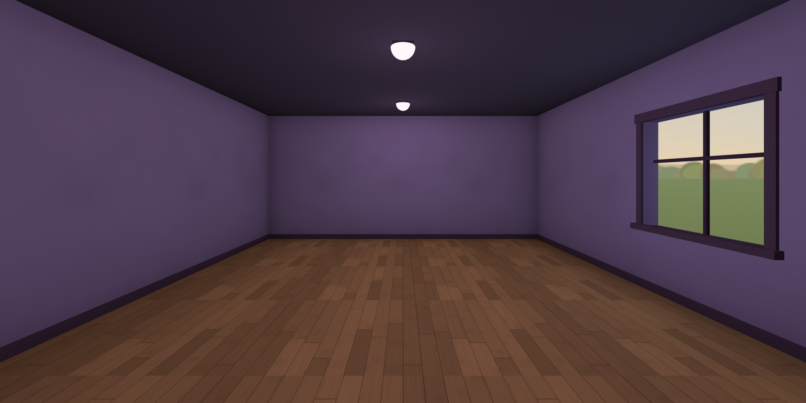

# arcade

**https://ariamokr.github.io/arcade/**

A room behind the [Hallway](https://ariamokr.github.io/hallway/)'s door, soon an arcade of old
computers, game consoles and arcade machines. For now it is the room
[AriaMoKr/RoomTemplateEmpty](https://github.com/AriaMoKr/RoomTemplateEmpty) makes, empty: a floor,
four walls, a ceiling with its lamps, a window onto the afternoon sky, and the doorway back to the
Hallway, in an arcade's dusk of violet walls and a dark ceiling. The machines come next: for now
they run on a page of their own (below, "The machines"). Walk it in VR on a Meta Quest, on a desktop
or on a phone. There is nothing to install.



Behind you as you come in is the doorway you came through, glowing magenta, with the Hallway seen
through it. Walk back through it (or click or tap it, or point at it in VR and pull the trigger) and
you are back in the Hallway, in front of this room's door. Beside it, on the wall, is the control
panel. The window is in the right-hand wall.

## The machines

Not in the room yet. For now they run on a bare page of their own,
[`mame/test.html`](https://ariamokr.github.io/arcade/mame/test.html), one at a time, to see that
each runs and how fast before it goes in. They come into the room a step at a time: the Nintendo
first, then the Spectrum with its keyboard, then an arcade cabinet. Breakout can't run fast enough
on the web (below, "How fast"), so what that cabinet holds is still to be chosen.

| Machine | What runs on it | Its licence |
|---|---|---|
| **Nintendo Entertainment System** (Nintendo, 1985) | [Concentration Room](https://github.com/pinobatch/croom-nes) 0.02 (Damian Yerrick, 2010), a game of pairs | GPL-3.0-or-later, and exact copies may be passed on without the source ([its notice](public/mame/software/croom/README.md)) |
| **ZX Spectrum 48K** (Sinclair Research, 1982) | its ROM: Sinclair BASIC, typed at its keyboard | Amstrad's: passed on with emulators, never for money ([its notice](public/mame/roms/spectrum/README.md)) |
| **Breakout** (Atari, 1976) | nothing: it is a board of logic chips with no program, which MAME runs chip by chip from its circuit | MAME's (below) |

Only what its licence lets GitHub Pages serve is served for them, a machine's own ROMs included.
Each file is in `public/mame/` with a README beside it saying what it is, where it came from and its
licence, and `npm test` checks that every machine's files have one.

On the test page, choose a machine and it starts. Its keys go to it while its screen has the focus
(choosing a machine gives it the focus; Tab leaves it, and Escape stops the machine):

| Machine | Keys |
|---|---|
| Nintendo | arrows: the pad · X: A · Z: B · Enter: Start · Shift: Select |
| Spectrum | its keyboard: the letters, digits, Enter and Space; Left Shift is CAPS SHIFT, Right Shift SYMBOL SHIFT |
| Breakout | 5: a coin · 1: Start · ←/→: the paddle · Space: Serve |

`?m=nes` (or `spectrum`, `breakout`) starts that one at once; `?view=3d` shows its screen in 3D, as
the room will; and `?xr=emulate` does so in an emulated Quest 3, with **Enter VR**.

### MAME

[MAME](https://www.mamedev.org/) 0.289 runs them, built for the web with Emscripten by
`tools/build-mame.sh` from only the three drivers they need (Breakout's holds Pong and Rebound
too): `public/mame/arcade.js` and `arcade.wasm`. Each machine runs in a frame of its own (`mame/machine.html`), stepped 60 times a
second from the page's frame loop (in VR, the headset's) whatever the display's rate, its sound
going through the page's. Only the machine's own keys reach it, never MAME's (Escape would end it,
Tab open its menu).

MAME is free software, under the GNU GPL, version 2 or later. Its licence and its parts' notices
are served beside it, [`public/mame/COPYING.txt`](public/mame/COPYING.txt), with the full texts
they name in [`public/mame/legal/`](public/mame/legal/), and its source is MAME's own at the tag
`mame0289`, https://github.com/mamedev/mame/tree/mame0289, built as it is: `tools/build-mame.sh`
says how. The build holds what Emscripten adds as well, each under its own licence, which
[`public/mame/legal/emscripten.txt`](public/mame/legal/emscripten.txt) gives: Emscripten's runtime
(MIT), SDL 3 and SDL_ttf (zlib), FreeType (the FreeType License), HarfBuzz (MIT) and zlib. Portions
of this software are copyright © 2026 The FreeType Project (www.freetype.org). All rights reserved.

It is committed, as built, so neither `npm install` nor the workflow builds it. To build it again
(after a change to the machines' drivers, or a new MAME), in MSYS2's UCRT64 shell on Windows, or in
any shell with Emscripten on Linux or macOS:

```bash
sh tools/build-mame.sh        # clones MAME once into ~/.cache/arcade/, builds it, copies it into public/mame/
```

### How fast

`npm run measure` (`tools/measure-machines.mjs`) runs each machine on the test page in headless
Chrome for 8 seconds: with the CPU as it is, slowed 4× and 6× (Chrome's CPU throttling, standing in
for a TV's), and in 3D in an emulated Quest 3's VR session. The figure to go by is what a step
costs, the time MAME takes to emulate 1/60 s, which has to fit into a 60 Hz frame (16.7 ms) with the
room's own drawing. On an Intel Core i9-14900HX laptop (and its integrated GPU), on 31 October 2026:

| A step: median (95th percentile) | CPU as it is | Slowed 4× | Slowed 6× | VR (emulated) |
|---|---|---|---|---|
| Nintendo | 2.0 ms (2.4) | 9.9 ms (18.5) | 13.3 ms (19.4) | 1.4 ms (1.7) |
| Spectrum | 1.3 ms (1.6) | 7.9 ms (12.6) | 11.7 ms (17.3) | 1.3 ms (1.6) |
| Breakout | 20.4 ms (25.9) | 143 ms (204) | 292 ms (369) | 20.6 ms (25.4) |

The figures vary by about a fifth from run to run.

- **The Nintendo and the Spectrum keep up.** At full speed a step takes 1–2 ms and the page's main
  thread is at most 13% busy, in VR too, and each starts within a second (served from the same
  computer, so with nothing to download). Slowed 4×, both still run at full speed, a step taking
  about half a frame (the Nintendo's slowest a whole one). Slowed 6×, a step takes most of a frame,
  so on a TV that slow the room would drop frames while one runs, and the Nintendo falls a little
  behind (51 steps a second). The TV itself is still to be measured.
- **Breakout doesn't keep up anywhere.** MAME runs its circuit chip by chip, and a step takes 20 ms
  even on this laptop (49 steps a second, the main thread always busy) and 143 ms slowed 4×. Pong,
  the same kind of machine, takes 8 ms, and 50 ms slowed 4×. So Breakout won't go into the room as
  it is; it stays on the test page for now, to see for yourself.

MAME is 33.6 MB to download (7.0 MB gzipped), and 0.3 MB of JavaScript (0.1 MB), fetched when a
machine first starts and then kept in the browser's cache. Concentration Room is 25 KB and the
Spectrum's ROM 16 KB.

## Moving about

As in the Hallway:

| | Look | Walk | Go back out | Wave (in a shared session) |
|---|---|---|---|---|
| Desktop | drag | WASD or arrows (Shift runs), Q/E or ←/→ turn, click the floor | click the doorway, or walk into it | the **Wave** button |
| Phone | drag | tap the floor | tap the doorway | the **Wave** button |
| Headset | your head | left stick walks (or aims a teleport), right stick turns, trigger at the floor teleports | trigger (or pinch) at the doorway, or step through it | squeeze a grip |
| Gamepad | right stick | left stick (click it in to hurry) | aim the dot at the doorway and press A, or walk into it | the **Wave** button |
| TV remote (below, "On a TV") | ←/→ turn | ↑/↓ | the dot on the doorway and OK, or walk into it; or Back | **Wave** in the card (Menu) |

Whatever hangs on the walls (below, "On the walls") is chosen as the doorway is: you walk up to it,
and on through it when it leads somewhere.

The walls stop you. **Fullscreen** and **Enter VR** are at the bottom right (not on a TV). The **control panel**
by the doorway holds Enter or exit VR, how to move and turn in VR (Smooth or Teleport, Snap or
Smooth), the comfort settings below, and Start or Leave shared session. The card at the top left
(the page's navigation) has the same choices as real controls under **Settings**, for a keyboard or
a screen reader, and **← Hallway** as a plain link. The VR choices are the Hallway's own: both read
and keep them in `localStorage` under `hallway.nav` ([AriaMoKr/common](https://github.com/AriaMoKr/common)'s
`nav.js`), so a choice made on either side of the door holds on the other.

### Settings for comfort

Three settings, on the panel and in the card's **Settings**, are shared the same way, under
`hallway.access` (common's `access.js`): set them anywhere on the site and they hold behind every
door.

| Setting | What it does here |
|---|---|
| **Motion**: System, Less or Full | With less motion (System follows the device's own setting) nothing glides: a click on the floor or the doorway is a jump, not a walk; the fades are blinks; the doorway's veil holds still; a waving visitor doesn't bob; and the page's own transitions stop. |
| **Vignette**: On or Off | In VR, while you glide or turn smoothly with the sticks, the edge of the view darkens and closes in, and opens when you stop. Snap turns and teleports blink instead. |
| **Seated**: On or Off | In VR, your view is raised 0.45 m, so sitting down you see the room from about standing height. |

## Coming in through the Hallway's door

The Hallway opens a door's room with the visit added to its address, by the door contract in
[AriaMoKr/common](https://github.com/AriaMoKr/common)'s README ("Going in", "Linking back"), whose
`door.js` the room reads it with. It reads it once and takes it off the address, so a reload, Back
or a shared link doesn't arrive again; `room` stays.

| Parameter | What the room does with it |
|---|---|
| `from=hallway`, `back`, `backname` | The doorway leads back to `back`, called the Hallway when it is the Hallway's own page (or, developing, when both are on this machine); any other address is named by its host, or by `backname`. Without `back`, it leads to the Hallway anyway, at `?from=arcade`, in front of this room's door. The way back lasts the tab (`sessionStorage`). |
| `dx`, `yaw`, `pitch` | You come in where you went through (`dx` across the doorway), turned and looking as you were. |
| `dw`, `dh`, `glow` | The doorway is that wide and high, and glows in that colour. |
| `room` | You stay in the shared session (below); the doorway back carries it on. |

Walking in from the Hallway's VR, Quest Browser can hand this page the immersive session without a
click (`sessiongranted`): the room listens for it from the first script on the page and takes it at
once, so you stay in VR, as long as both are on `ariamokr.github.io`.

Through the doorway you see the Hallway: the view it publishes out of its door to here
(`views/views.json` beside the Hallway, under `arcade`; common's README, "The view from your door").
Until the Hallway has a door to here and has published that view, and whenever the way back is not
the Hallway, the doorway shows its glow and the name of where it leads.

## The Hallway's door

The Hallway has no door to here yet: it comes in the Hallway's own round. Its entry in the Hallway's
[`public/js/environments.js`](https://github.com/AriaMoKr/hallway/blob/main/public/js/environments.js)
is the config's `hallwayDoor()`:

```js
{
  id: 'arcade',
  title: 'arcade',
  subtitle: "An empty room behind the Hallway's door, soon an arcade of old computers, game consoles and arcade machines. Walk it in VR on a Meta Quest, on a desktop or on a phone.",
  sign: 'Arcade',
  url: 'https://ariamokr.github.io/arcade/',
  preview: 'https://ariamokr.github.io/arcade/hallway-preview.jpg',
  color: '#d36fd8',
},
```

As the Hallway's README asks ("Adding a door"), the title on the plaque by the door is the
repository's name and the subtitle is the page's description word for word, so when the
description changes, the Hallway's entry changes with it. Once the Hallway has rendered its `views/`
with the door, the doorway back here shows the hall.

## Together

The Hallway's shared session ([AriaMoKr/layersharedsession](https://github.com/AriaMoKr/layersharedsession),
peer to peer over WebRTC) comes in here too. Come in from the Hallway in a session and you join the
same room here, as `arcade`; the others in here are drawn by the layer's avatars.
**Start shared session**, on the panel or in the card, starts one here; **Copy invite link** copies
its address (on a TV the card shows it, to open on a phone or a computer), **Wave** (or a grip in
VR) waves to everyone in it, and the card has your name in it, to change. The doorway back carries
the session into the Hallway.

## On the walls

What hangs on a room's walls is in its config, `pieces`: none here yet, as the walls are for the
machines. Each is a framed picture with its title on a label under it (over it when it hangs low),
and it may lead somewhere. Choose one (click or tap it, point at it in VR and pull the trigger, or
put the dot on it and press A or OK) and you walk up to it; one with a `link` then takes you there as
the doorway takes you back, fading out, the shared session carried on (in VR, or with less motion, at
once). The card lists them under **On the walls**: the ones that lead somewhere as links, the rest as
buttons that walk you up to them, each with its description. With pieces on the walls, the hints
name the pictures too (click, tap or aim at one), and on a TV the hint says what OK does with the dot
on one ("On a TV").

The way out is common's `hallLink` (its README, "Another hall"): the place gets `back`, this room's
address at `?from=<the piece's id>`, and `backname`, the room's title, so a place that reads the door
contract offers the way back here by name. Coming back by it you stand in front of the piece, facing
into the room, and the doorway still leads where it did (the way back kept for the tab). In VR, Quest
Browser hands the place the immersive session as it does the Hallway's rooms, when both are on
`ariamokr.github.io` and the place takes it.

```js
pieces: [
  {
    id: 'studio',                 // its own, 1–32 of a–z, 0–9 and - (?from=studio comes back to it), not 'hallway'
    wall: 'left',                 // 'left', 'right' or 'far', facing in from the doorway
    at: 2,                        // metres along the wall from its middle, to the right as one faces it
    y: 1.5,                       // its middle's height
    width: 1.2, height: 0.6,      // the picture's size; the frame goes round it
    image: 'gallery/studio.jpg',  // relative to the page (in public/), cropped from its middle to fit
    title: 'The studio',          // on its label, and in the card
    description: 'VARTISTE, a painting studio in VR.', // in the card, and for screen readers
    link: 'https://ariamokr.github.io/vartiste/',      // where it leads; leave it out for a picture
  },
],
```

`npm test` checks that each fits: on its wall, over the skirting, under the ceiling, clear of the
window and of the others, with its picture in `public/` (`pieceProblems` in `room.js` says what is
wrong). The frames are in the room's wood and the labels share one mesh, but each picture is a draw
call and a texture of its own, against the TV's budget ("On a TV").

## On a TV

In the Hallway's Android TV app ([AriaMoKr/HallwayApp](https://github.com/AriaMoKr/HallwayApp): the
site full screen in a WebView whose user agent ends ` HallwayTV/<version>`), or in any browser with
`?tv=emulate`, the room is walked with the TV's remote, as common's README has it ("The TV app"),
through its `tv.js`:

- The arrows walk and turn. OK uses what the dot in the middle of the view is on: the doorway, a
  picture on the walls, a button on the panel, or the floor (it walks there). With the dot on a
  picture, the hint says what OK does there: `OK: The studio` for one that leads somewhere,
  `OK: walk up to …` for the rest. It comes back for that if it had faded, and fades again when the
  dot leaves.
- **Menu** (or holding Back) moves the focus into the card, starting at **← Hallway**. There, up
  and down go from control to control, left and right go through a choice, and OK chooses. The card
  holds Start or Leave shared session; in a session, Wave, your name, and the invite link as text
  (there is nothing to copy it to); and Settings, with every button on the panel. **Back** walks
  again.
- Stepping onto your name keeps the TV's keyboard down, so the arrows go on past it. OK brings the
  keyboard up to type, and Enter keeps the name.
- Back while walking goes back a page, to the room's door in the Hallway.
- There is no Fullscreen or Enter VR. The card and the hint are the 10-foot view (`html.tv` in
  `style.css`): the page is 960 × 540 at a pixel ratio of 2, with larger text, focus rings that show
  from across the room, and the TV's safe margins.
- The hint is also the view's description, which TalkBack reads. Once it has faded, it leaves the
  reading order, so TalkBack doesn't stop on an empty spot.

What the room adds keeps the remote working if:

- **What it adds in 3D works with OK.** Anything a click or a tap uses, OK uses too, when
  `controls.js`'s `use` handles it (the room's subclass of common's `Controls`: its own first, then
  `super.use`). Anything used only with a letter key, the mouse or a control in 3D is also a real
  control in the card, where the remote reaches it.
- **It reads keys through `keyOf(e)`** (common's `tv.js`). The remote's OK, and keys sent with
  `adb shell input keyevent`, come with no `code`.
- **Back undoes its own step first.** If the room has something to step back from (a machine
  started, a text opened), Back undoes it: that goes in `main.js`'s `stepBack`, which returns true
  when it took a step. Otherwise the app goes back a page.
- **A text box needs nothing of its own.** Common's remote keeps the TV's keyboard down while it
  steps onto a box and past it, and brings it up on OK. Don't give a box `inputmode="none"`.
- **Nothing needs a keyboard, a pointer or a headset alone**, and there are no local-file controls.
- **It stays within the frame budget.** On the TV it was measured on (a Sony BRAVIA 4K VH21:
  Android 12, a Mali-G52, WebView 155), the template's empty room holds 60 fps at 1080p at a pixel
  ratio of 2: 241 frames, none dropped, the 95th percentile at 16.8 ms. That full frame is the budget
  the room's contents can spend. Check it with HallwayApp's `tools/tv-check.mjs --url <the room's
  address>` (a debug build), and keep it at 60.

## Running it

You need Node.js 22 or newer.

```bash
npm install       # three.js, common, the shared-session layer, Trystero and IWER, copied into public/vendor/ by common's tools/vendor.mjs from vendor.json
npm start         # http://localhost:8102/
npm test          # node --test: the config, where you may walk, the way back's address, the vendor list, the page, and tsc's check of public/js/
npm run types     # tsc's checks alone
npm run preview   # public/hallway-preview.jpg and public/social.jpg, in headless Chrome
npm run measure   # how fast each machine runs, in headless Chrome (above, "How fast")
```

`public/` is the whole site: any static server can serve it once `npm install` has filled
`public/vendor/`. `?xr=emulate` installs Meta's IWER emulator (a virtual Quest 3), and `?tv=emulate`
shows the TV's page (Escape stands in for Back in the card, and `hallwayTV.menu()` in the console
for Menu). For a Quest or the TV over adb, `adb reverse tcp:8102 tcp:8102` and start the server on
IPv4 (`npm start -- --host 127.0.0.1`).

`npm test` type-checks `public/js/` with TypeScript, from the modules' JSDoc (`tsconfig.json`:
`allowJs`, `checkJs`, `noEmit`), against three.js's types and common's and the shared session's.
Nothing is built: the page is served as it is, and the import map stays. What TypeScript's DOM
library leaves out is in `types/globals.d.ts`. `strict` comes a file at a time:
`tsconfig.strict.json` checks only the files that pass it (so far `config.js`, `presence.js`,
`room.js` and `controls.js`), and `npm test` runs it too. A file joins its `include` when a change
makes it pass. `tools/` and `test/` come later.

To try the way in and out locally, serve the Hallway's checkout as well (on 8088) and open the room
as its door would:

```
http://localhost:8102/?from=hallway&back=http%3A%2F%2Flocalhost%3A8088%2F%3Ffrom%3Darcade&dx=0.2&yaw=-15&pitch=-5&dw=1.1&dh=2.25&glow=d36fd8
```

## The pictures

`npm run preview` (`tools/preview.mjs`) renders two pictures in headless Chrome, and they are
committed:

- `public/hallway-preview.jpg`, 2048 × 1024: the room from where one arrives, at eye height, facing
  in, hung as the Hallway hangs its doorways' pictures. The Hallway's doorway to here shows it.
- `public/social.jpg`, 1280 × 640: the room from across it, looking back at the doorway and the
  window. The page's `og:image` and `twitter:image` show it, and it is the repository's social
  preview (Settings → General → Social preview, uploaded by hand).

Render them again whenever the room changes. Chrome starts through common's `tools/chrome.mjs`, on a
new profile that is first told the Windows password is not blank, so it never tries a logon to find
out. Never start Chrome for these by hand on a new profile.

## Made from RoomTemplateEmpty

The repository was made from [AriaMoKr/RoomTemplateEmpty](https://github.com/AriaMoKr/RoomTemplateEmpty)
by its README's "Making a room from this template". What makes it this room rather than the template
is [`public/js/config.js`](public/js/config.js) (the id `arcade`, its title, description, sign and
address, its size, 7 × 9 m, its colours, the window in the right-hand wall and the sky's yaw, the
port 8102, the magenta glow `#d36fd8`), with `package.json`, `index.html`, `.claude/launch.json`,
`main.js`'s opening comment, the pictures and these notes to match; `npm test` checks the page and
the package say what the config says. The rest of `public/js/` is still the template's, ready for
the machines.

The template's fixes come here by merge (the remote `template` is AriaMoKr/RoomTemplateEmpty, and
the two histories join at its `df35b83`, which this repository's first commit copies):

```bash
git remote add template https://github.com/AriaMoKr/RoomTemplateEmpty.git   # once
git fetch template
git merge template/main
```

In a merge, arcade keeps its own `config.js` values, `index.html`, `package.json`'s name and
description, the two pictures, the port 8102 and `main.js`'s opening comment, and its README says
what the template's says in arcade's words. If `package.json` or `package-lock.json` conflict,
arcade keeps its name and description and takes the template's dependencies, and `npm install`
makes the lockfile again.

## Publishing

`.github/workflows/pages.yml` publishes `public/` to GitHub Pages on every push to `main`, after
the tests (tsc's check among them), through the sites' workflow in
[AriaMoKr/common](https://github.com/AriaMoKr/common) (`v0.7.1`, on Node 24). Every URL in the page is relative, so it works under any repository's path.

## License

[MIT](LICENSE), for the room's own code. `public/mame/` holds MAME and what its machines run, each
under its own licence (above, "The machines").
